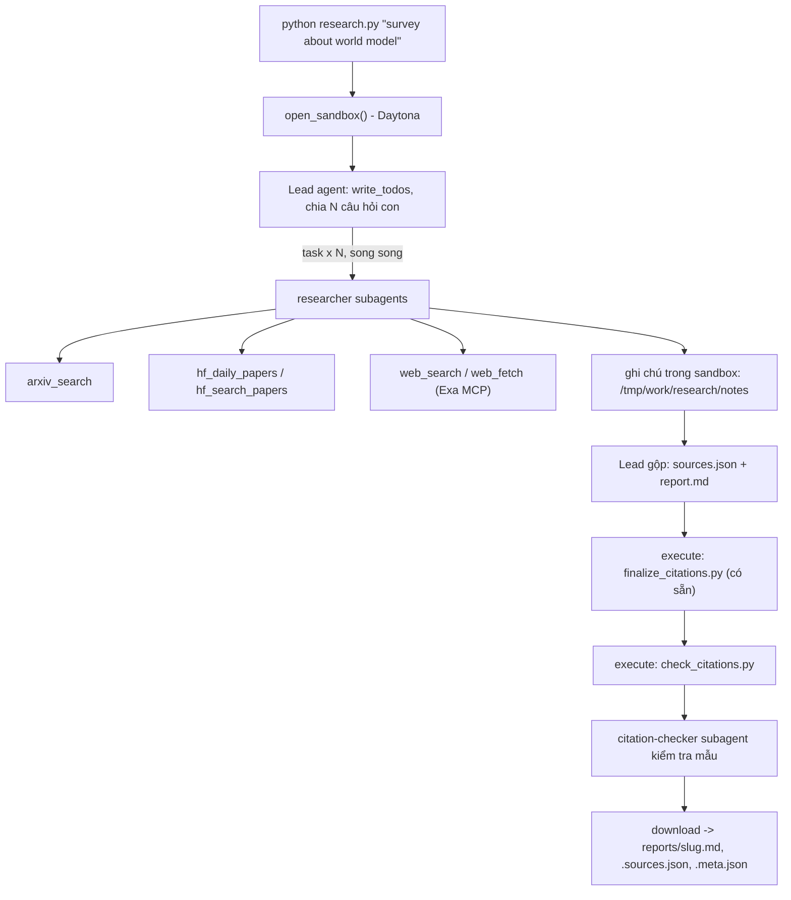

# Deep Research Agent (Deep Agents + Sandbox)

Lab dựng một **hệ thống deep research đa tác tử**: người dùng chỉ cần nhập một chủ đề (ví dụ `survey about world model`), hệ thống tự lập kế hoạch, giao việc cho nhiều subagent, tìm tài liệu trên arXiv, Hugging Face và web, rồi viết một **báo cáo có trích dẫn**.

Hình thức: **bài thực hành cá nhân**. Ngôn ngữ lập trình: Python 3.11 trở lên.

## 1. Mục tiêu học tập

Sau lab, bạn có thể:

1. Dựng agent bằng thư viện Deep Agents (LangChain): công cụ (tool), system prompt, subagent, backend.
2. Dùng **sandbox** (Daytona) làm không gian làm việc và nơi chạy mã cho agent; hiểu vì sao khóa API và công cụ mạng phải nằm ở phía host chứ không nằm trong sandbox.
3. Viết công cụ gọi API ngoài **chịu được giới hạn tốc độ** (retry, backoff, jitter, `Retry-After`).
4. Thiết kế quy trình đa tác tử: lead chia nhỏ câu hỏi, giao cho N researcher chạy song song, tổng hợp và kiểm tra trích dẫn.
5. Tạo báo cáo có thể kiểm chứng: mọi khẳng định có `[n]` trỏ tới một nguồn có thật.

## 2. Hệ thống làm gì



Nguồn dữ liệu:

| Nguồn | Dùng để |
|---|---|
| arXiv API `https://export.arxiv.org/api/query` | Tìm bài theo từ khóa, sắp theo ngày |
| Hugging Face Daily Papers `/api/daily_papers` | Bài đang "trending": upvotes, githubRepo, summary |
| Hugging Face papers search `/api/papers/search?q=` | Tìm bài theo chủ đề |
| Web qua Exa MCP (`web_search_exa`, `web_fetch_exa`) | Blog, survey, trang dự án, nội dung đầy đủ của một URL |

## 3. Cấu trúc thư mục

```
Lab/
├── README.md  GUIDE.md  RUBRIC.md  REPORT_TEMPLATE.md   tài liệu
├── topics.md                 5 chủ đề cần chạy
├── requirements.txt  .env.example  .gitignore
├── model.py                  CÓ SẴN - không sửa: tạo mô hình LLM từ biến môi trường
├── sandbox.py                CÓ SẴN - không sửa: sandbox Daytona (hoặc Docker), upload, download
├── self_check.py             CÓ SẴN - không sửa: tự kiểm tra trước khi nộp (python self_check.py)
├── finalize_citations.py     CÓ SẴN - không sửa: script chạy trong sandbox, tự sinh `## References` và đánh số lại trích dẫn
├── tools.py                  SINH VIÊN CÀI ĐẶT: retry + 5 công cụ nguồn dữ liệu
├── agents.py                 SINH VIÊN CÀI ĐẶT: prompt, subagent, lead agent
├── research.py               SINH VIÊN CÀI ĐẶT: script chính
├── check_citations.py        SINH VIÊN CÀI ĐẶT: kiểm tra trích dẫn, chạy TRONG sandbox
└── reports/                  báo cáo sinh ra (bạn commit vào repo nộp)
```

Mỗi tệp "SINH VIÊN CÀI ĐẶT" là **pseudo-code chạy được** (import được): các hàm có docstring mô tả việc cần làm, các `TODO n` đánh số theo `GUIDE.md`, thân hàm đang `raise NotImplementedError`.

## 4. Cài đặt

```bash
python3 -m venv .venv && source .venv/bin/activate      # Python 3.11+
pip install -r requirements.txt
cp .env.example .env                                     # rồi điền khóa CỦA BẠN
```

Bạn cần ba loại khóa (điền vào `.env`, **không bao giờ commit** `.env`):

| Khóa | Lấy ở đâu | Ghi chú |
|---|---|---|
| LLM (`LAB_MODEL` + khóa nhà cung cấp) | Nhà cung cấp bạn chọn (OpenAI, Anthropic, Google, OpenRouter, Ollama...) | Mô hình **phải hỗ trợ tool calling**. Chép tên mô hình từ tài liệu của nhà cung cấp. |
| `DAYTONA_API_KEY` | https://app.daytona.io | Kiểm tra gói miễn phí / credit hiện hành. Không có tài khoản hoặc hết credit: đặt `SANDBOX=docker` để chạy sandbox trong container Docker cục bộ (xem `.env.example`). |
| `EXA_API_KEY` (khuyến nghị) | https://dashboard.exa.ai/api-keys | Có thể chạy không khóa, nhưng bản miễn phí của MCP bị giới hạn tốc độ rất nhanh. |

## 5. Làm bài

Làm theo thứ tự (chi tiết trong `GUIDE.md`):

1. `check_citations.py`: khởi động nhẹ, thuần Python.
2. `tools.py`: viết `with_retry` và 5 công cụ. Thử riêng từng công cụ: `python tools.py`.
3. `agents.py`: viết prompt, subagent và lead agent.
4. `research.py`: ghép tất cả; chạy một chủ đề:

```bash
python research.py "survey about world model"
```

Kết quả nằm ở `reports/survey-about-world-model.md` cùng `.sources.json` và `.meta.json`.

## 6. Chủ đề và nộp bài

- Chạy đủ **5 chủ đề** trong [`topics.md`](topics.md), mỗi chủ đề một lần.
- Commit mã nguồn và toàn bộ `reports/`, đẩy lên một **public repo** GitHub và nộp link.
- Kiểm tra trước khi nộp: chạy **`python self_check.py`** (không tốn token): nó kiểm tra đủ 5 báo cáo, `meta.json`, trích dẫn bằng `check_citations.py` của bạn, và không có `.env`/khóa nào trong git.
- Cách chấm: xem [`RUBRIC.md`](RUBRIC.md).

## 7. Thời gian, chi phí và an toàn

- Dùng một mô hình **rẻ nhưng hỗ trợ tool calling**, và **đặt giới hạn** (số lần gọi mô hình/công cụ cho lead và subagent, `recursion_limit`): một prompt hỏng có thể khiến agent lặp rất lâu. Đây là hạng mục 2.5 của `RUBRIC.md`.
- Kết quả có tính ngẫu nhiên: cùng một mã có thể cho báo cáo hợp lệ ở lần này và trích dẫn lỗi ở lần sau. Hãy sửa **prompt và mã**, không sửa tay báo cáo.

- Mỗi lần chạy tốn token LLM và thời gian sandbox. `tokens` trong `meta.json` chỉ đếm tin nhắn của lead, chưa gồm subagent, nên chi phí thật cao hơn. `open_sandbox()` luôn dừng và xóa sandbox khi kết thúc, kể cả khi lỗi. Đừng bỏ qua nó.
- **Không đưa bí mật vào sandbox.** Sandbox không ngăn được prompt injection hay việc đẩy dữ liệu ra mạng; một trang web độc hại có thể khiến agent chạy lệnh bên trong sandbox. Vì vậy mọi công cụ gọi mạng và mọi khóa ở lại phía host.
- Nội dung lấy từ web là **dữ liệu không đáng tin**: agent không được làm theo chỉ dẫn nằm trong đó.

## 8. Bài làm này: chạy, kiểm thử, đọc kết quả

Mã đã cài đặt: `check_citations.py`, `tools.py`, `agents.py`, `research.py`, và `merge_notes.py` (thêm mới, chạy trong sandbox). Các tệp `model.py`, `sandbox.py`, `finalize_citations.py`, `self_check.py` giữ nguyên.

**Chạy một chủ đề** (sau khi làm theo mục 4):

```bash
source .venv/bin/activate
python research.py "survey about world model"      # mã thoát 0 = có báo cáo hợp lệ; 1 = lần chạy hỏng, không ghi gì
```

**Biến môi trường tùy chọn** (xem `.env.example`), dành cho LLM miễn phí hay gateway hay lỗi:

| Biến | Tác dụng |
|---|---|
| `LAB_FALLBACK_MODELS` | Danh sách model (cách nhau dấu phẩy, cùng endpoint với `LAB_MODEL`) để chuyển sang khi model hiện tại lỗi, chậm hoặc trả tin nhắn rỗng. |
| `LAB_TIMEOUT` | Số giây chờ một câu trả lời trước khi bỏ và hỏi lại (mặc định 60). |
| `LAB_MAX_RPS` | Giới hạn số lần gọi model mỗi giây, dùng chung cho lead và mọi subagent. |

**Kiểm thử không tốn token** (cần `pip install pytest`):

```bash
python -m pytest -q          # with_retry, công cụ (HTTP giả), validator, gộp ghi chú, chuỗi model dự phòng, save_outputs
python tools.py              # gọi thật cả 5 công cụ, không cần LLM
python self_check.py         # kiểm tra 5 báo cáo, meta.json, trích dẫn, không lộ khóa trong git
```

**Đọc `reports/`.** Mỗi chủ đề có ba tệp cùng `<slug>` (xem `REPORT_TEMPLATE.md`):

| Tệp | Nội dung |
|---|---|
| `<slug>.md` | Báo cáo: TL;DR, Background, các phần theo chủ đề, Trends and open problems, `## References` (một dòng cho mỗi nguồn). `[n]` trong thân trỏ tới dòng `[n]` ở References. |
| `<slug>.sources.json` | Mảng `{n, id, url, title, date, source}`; `source` là công cụ đã trả nguồn (`arxiv`, `hf-daily`, `hf-search`, `web`). |
| `<slug>.meta.json` | Bằng chứng chạy: model, thời gian, `subagent_calls`, `tool_calls`, `tokens` (chỉ của lead), `n_sources`, `source_families`. |

Kiểm tra một báo cáo bằng tay: `python3 check_citations.py reports/<slug>.md reports/<slug>.sources.json` (phải in `OK`).

**Thiết kế ngắn gọn.** Lead lập kế hoạch và giao 4-5 câu hỏi con cho `researcher` chạy song song (công cụ mạng chạy ở host, khóa không vào sandbox). Researcher ghi ghi chú; `merge_notes.py` gộp ghi chú thành `sources_all.json` **bằng mã** (không để LLM chép tay URL). Lead viết thân báo cáo vào `draft.md`, rồi dựng báo cáo cuối bằng `finalize_citations.py` và kiểm bằng `check_citations.py` (chạy trong sandbox). Lead giữ riêng danh sách nguồn đầy đủ và bản nháp vì finalizer xóa nguồn không được trích dẫn, nên mỗi lần chạy lại đều dựng từ hai tệp đó. `citation-checker` kiểm mẫu vài khẳng định.

**Các lớp bảo vệ** (vì model yếu hoặc quá tải rất hay làm sai, và nguồn bịa làm báo cáo mất điểm):

1. *Nguồn gốc.* Host ghi lại mọi thứ công cụ đã trả về. Researcher bị từ chối ghi một tệp ghi chú chứa `url:` chưa từng do công cụ nào trả về; sau khi chạy, `research.py` kiểm lại mọi URL trong `sources.json`. Nguồn bịa thì lần chạy bị hủy và không ghi gì.
2. *Validator trên host.* Trước khi lưu, `research.py` chạy `check_citations` đầy đủ (trích dẫn, bố cục đúng mẫu, tối thiểu 3 họ nguồn, thân báo cáo tối thiểu 1000 từ, mọi nguồn có tiêu đề). Báo cáo hỏng không ghi đè báo cáo tốt.
3. *Chịu lỗi LLM.* Lỗi 429/5xx/timeout được thử lại có backoff; model lỗi, chậm hoặc trả rỗng thì chuyển sang model kế tiếp trong `LAB_FALLBACK_MODELS`.
4. *Giới hạn chi phí.* Lead và mọi subagent (kể cả `general-purpose` mặc định của `deepagents`) đều có giới hạn số lần gọi model/công cụ (`agents.py`).
